# MisconfigBench: ICLR Paper Writing Blueprint

This document is a paper-writing and experiment-design blueprint for
MisconfigBench. It is grounded in the repository implementation as of 2026-08-19.
It intentionally distinguishes implemented facts from claims that require new
experiments. Do not replace bracketed placeholders with invented numbers.

## 1. One-Sentence Positioning

MisconfigBench is a containerized benchmark for evaluating whether software
engineering agents can diagnose and repair realistic configuration failures
through a constrained configuration surface, using behavior-based hidden
evaluation rather than exact patch matching.

The core scientific claim should not be “agents can edit configuration files.”
The stronger claim is:

> A valid troubleshooting benchmark must evaluate an intervention on a fresh,
> faulty environment, verify restored user-facing behavior, and reject shortcut
> repairs that merely suppress the symptom or weaken required invariants.

This framing puts the work at the intersection of agentic software engineering,
runtime environments, and robust evaluation. It is more distinctive than
presenting it as another collection of Docker tasks.

## 2. Current Repository Snapshot

The following statements are supported by the current repository and can be
used as implementation facts.

| Item | Current state |
| --- | --- |
| Validated instance contracts | 6: CA1, CA14, CA35, CB116, CD152, CD158 |
| Software | MySQL 8.0/8.0.27, MySQL 5.6, Apache Hadoop 3.3.6, nginx 1.18.0 |
| Covered taxonomy subtypes | CA-1, CA-2, CB-1, CD-2 |
| Taxonomy design | 4 top-level types and 14 subtypes |
| Agent roles | Builder, deterministic Verifier, OpenHands-based Fixer |
| Fixer observability | task prompt, trajectory, run state, patch, and replay result |
| Evaluation | dynamic fresh baseline, patch-scope policy, F2P and P2P behavior checks |
| Image distribution | local image, immutable registry digest, optional offline archive |
| Public release boundary | task descriptions and image references can be exported; oracle metadata, patches, and harnesses remain private |

The present collection is a proof-of-system, not yet a convincing ICLR-scale
benchmark. The paper must describe it as a pilot or development version until
the scale, diversity, and baseline results specified below are complete.

## 3. Title Candidates

Choose a title that foregrounds the benchmark’s evaluation principle, rather
than a specific agent framework.

1. **MisconfigBench: Behavior-Grounded Evaluation of Agents for Configuration Troubleshooting**
2. **Beyond Patch Matching: A Benchmark for Agentic Misconfiguration Repair**
3. **MisconfigBench: Hidden-Oracle Container Environments for Reliable Configuration Repair**
4. **Evaluating Diagnosis and Repair of Runtime Misconfigurations with Fresh-Environment Replay**

Recommended title: **MisconfigBench: Behavior-Grounded Evaluation of Agents for
Configuration Troubleshooting**.

## 4. Abstract Draft

Use the following as a draft after replacing bracketed fields with measured
values. Keep the final abstract around 150–200 words.

> Configuration failures are a major source of production incidents, yet
> existing software-engineering benchmarks primarily evaluate code edits or
> accept an exact reference patch. These settings do not capture the operational
> requirement of troubleshooting: an agent must identify a fault from an
> observable symptom, modify only an appropriate configuration surface, restore
> behavior, and preserve safety-critical invariants. We introduce
> **MisconfigBench**, a containerized benchmark for behavior-grounded
> misconfiguration repair. Each instance provides an already-faulty runtime
> environment and a public operational task, while keeping the root-cause label,
> repair policy, behavioral tests, and canonical patch hidden from the agent.
> MisconfigBench evaluates a predicted patch by replaying it on a fresh faulty
> container, enforcing patch scope, checking fail-to-pass behavior, and checking
> pass-to-pass invariants that reject shortcut repairs. The benchmark organizes
> failures with a controlled taxonomy spanning constraint violations, resource
> unavailability, component integration errors, and semantic
> misinterpretation. Across [N] instances covering [S] software systems and [T]
> subtypes, we evaluate [K] agent configurations and find that [main measured
> result]. Ablations show that [measured result about hidden oracle, P2P, or
> dynamic replay]. MisconfigBench provides [release artifact] for studying
> reliable operational repair agents.

## 5. Problem Definition

### 5.1 Environment and Information Boundary

For each benchmark instance \(i\), define a faulty container image
\(E_i^{fault}\), a public task description \(d_i\), and a hidden oracle
\(O_i\). An agent receives only \(d_i\) and controlled tools operating inside a
running container instantiated from \(E_i^{fault}\).

The hidden oracle contains:

- a taxonomy label and root-cause metadata;
- the permitted configuration files \(A_i\);
- optionally, required configuration options \(R_i\);
- forbidden shortcut classes \(F_i\);
- F2P behavior checks \(\mathcal{T}_i^{F2P}\);
- P2P invariant checks \(\mathcal{T}_i^{P2P}\);
- a canonical patch used only to validate the instance.

The agent produces a state change inside the diagnostic container. MisconfigBench
exports only files in \(A_i\), computes a unified diff against an independently
created fresh baseline, and treats that diff as the predicted patch \(p_i\).

### 5.2 Acceptance Function

Let \(Apply(E_i^{fault}, p_i)\) create a fresh repaired environment. Define:

\[
\operatorname{Pass}(p_i) =
\operatorname{Scope}(p_i, A_i)
\land \operatorname{Required}(p_i, R_i)
\land \operatorname{Applies}(p_i, E_i^{fault})
\land \bigwedge_{t \in \mathcal{T}_i^{F2P}} t(Apply(E_i^{fault},p_i))
\land \bigwedge_{t \in \mathcal{T}_i^{P2P}} t(Apply(E_i^{fault},p_i)).
\]

`Scope` prevents edits outside the intended repair surface. `Required` is used
only for cases that are explicitly designed to test a particular option.
`Applies` prevents patches crafted for the agent’s mutated container rather than
the original faulty state. F2P verifies the desired recovery; P2P verifies that
an invariant still holds after repair.

This formulation is a central paper contribution. It separates the observable
repair objective from a single gold diff and makes acceptance robust to multiple
semantically valid repairs.

## 6. Technical Route

```mermaid
flowchart LR
  D[Public case description] --> B[Builder]
  B --> C[Instance contract + clean/fault overlays]
  C --> I[Faulty Docker image]
  I --> V[Verifier]
  V -->|reproduce symptom, validate gold patch, F2P/P2P| R[Validated instance]
  R --> F[Fixer agent]
  F -->|container-only terminal and file editing| M[Mutated diagnostic container]
  M --> P[Export allowed files and derive prediction patch]
  P --> E[Hidden replay evaluator]
  E -->|fresh faulty baseline + scope + F2P + P2P| S[Structured pass/fail result]
```



### 6.1 Builder: From Operational Description to Runnable Instance

The Builder consumes one case-specific artifact, `meta/description.md`, and
generates the rest in an isolated run workspace. Its generated artifacts include
the instance manifest, private metadata, base and fault overlays, build
requirements, reproduction script, F2P/P2P checks, evaluator harness, and gold
patch.

The host does not trust generation blindly. It validates the structured
contract, builds a clean base image followed by a faulty instance image, runs
the reproduction script, verifies that each F2P test fails before repair and
each P2P test passes before repair, then applies the gold patch and requires
the evaluator to pass. This creates a useful separation between *generation*
and *acceptance*.

The paper should emphasize this distinction. A benchmark generated by an LLM is
not trustworthy merely because it has a plausible description; it needs an
executable acceptance gate.

### 6.2 Verifier: Deterministic Instance Certification

The current Verifier is not an LLM agent. It is a deterministic certification
runner that starts a fresh faulty container, runs the configured reproduction
script, then evaluates the reference patch through the hidden evaluator. It is
best described in the paper as an **instance verifier** or **certification
stage**, not as an autonomous reasoning agent.

This distinction matters for reproducibility. Builder and Fixer may use an LLM,
but the decision that an instance is valid must be deterministic and replayable.

### 6.3 Fixer: Container-Bounded Troubleshooting

The Fixer receives a rendered public prompt and two controlled tools:

- a terminal tool for commands inside the case container;
- a file editor for absolute paths inside that container.

The fixer does not receive `instance.json`, private metadata, gold patches, the
allowed-file list, or evaluator scripts. Its tool operations are restricted to
the diagnostic container, not the evaluator host. Following the run, the host
exports only private-policy allowed files and derives the patch by comparing
against files extracted from a new baseline container.

This design reduces two forms of benchmark leakage: directly reading the hidden
oracle, and producing a patch relative to a mutated or non-reproducible local
state.

### 6.4 Dynamic Replay Evaluator

Each case supplies a private `eval_patch.sh` that accepts a prediction patch and
an optional image name. The evaluator extracts configuration files from a new
faulty image, applies the patch in a temporary staging area, enforces scope,
copies only allowed files into a second fresh container, and executes F2P and
P2P scripts. The Python evaluator selects the container’s actual architecture
before launching the harness, avoiding host/image architecture warnings on
Apple Silicon.

Dynamic replay is important: it rules out repairs that work only because the
agent accidentally changed unrelated state such as a running process, generated
file, or temporary database state.

### 6.5 Taxonomy

The controlled taxonomy contains four top-level classes:

| ID | Type | Subtypes |
| --- | --- | --- |
| CA | Constraint violation | syntax, invalid option, misplaced configuration, duplicate option, intra-component, cross-component |
| CB | Resource unavailability | identifier mismatch, competition, unauthorized access, hardware limitation |
| CC | Component integration error | incompatibility, missing component |
| CD | Configuration semantic misinterpretation | ambiguous option, value–requirement mismatch |

The taxonomy ID is private instance metadata. This avoids leaking the root-cause
family to the fixer while making post-hoc analysis and balanced split design
possible.

## 7. What Is Novel Relative to Existing Benchmark Styles

The paper should make precise comparisons along axes, not rely on broad claims
that other benchmarks are “less realistic.”

| Axis | Typical code-repair benchmark | Configuration corpus | MisconfigBench target design |
| --- | --- | --- | --- |
| Primary artifact | repository source code | static configuration files | running faulty service environment |
| Agent observation | issue and codebase | labeled config example | operational symptom plus container tools |
| Repair output | source patch | label or text prediction | configuration patch derived from container state |
| Correctness | tests and/or exact patch | label accuracy | fresh-environment replay plus behavioral checks |
| Shortcut control | varies | generally absent | P2P invariants and forbidden shortcuts |
| Oracle exposure | often public tests | labels are public | policy, tests, and gold patch hidden |
| Reproducibility | repository setup | file-level | immutable container references and optional archives |

In related work, discuss FeatureBench, EnConda-Bench, and SEC-bench using their
published task construction and evaluation protocols. Before submission, verify
all factual comparative language against their current papers/repositories and
add formal BibTeX citations. A useful positioning sentence is:

> MisconfigBench complements existing configuration and feature-oriented
> benchmarks by treating a configuration failure as a stateful operational
> repair problem with a hidden behavioral oracle.

Avoid saying that it “outperforms” or “replaces” any benchmark; the contribution
is a different evaluation target.

## 8. Recommended Paper Structure

### 1. Introduction

Open with a short incident-style example: a user-facing command fails while the
service appears installed and reachable; the cause is an option value, parser
escaping rule, endpoint mismatch, or configuration artifact. Explain why source
code repair benchmarks do not test this loop.

State three concrete contributions:

1. A behavior-grounded formalization of configuration repair with scope and
   invariant constraints.
2. A containerized benchmark protocol with hidden oracle separation and fresh
   replay evaluation.
3. A controlled taxonomy and an instance-construction/certification pipeline
   for reproducible misconfiguration tasks.

Only claim “a comprehensive benchmark” after the instance expansion plan is
completed.

### 2. Related Work

Organize by evaluation setting rather than a long list of tools:

- repository-level software engineering agents and patch benchmarks;
- configuration analysis, diagnosis, and misconfiguration datasets;
- interactive/containerized agent benchmarks;
- robust evaluation, hidden tests, and contamination-resistant protocols.

For each group, explain one limitation that motivates MisconfigBench’s specific
protocol: static artifacts cannot expose runtime behavior; exact patches reject
alternative valid fixes; public tests create leakage; ordinary positive tests do
not rule out disabling security or changing unrelated state.

### 3. MisconfigBench Task and Protocol

Use the formal definition in Section 5, then explain public versus private
artifacts. Include a figure based on the technical route above. This is the
method section’s center of gravity.

### 4. Instance Construction and Certification

Explain clean base image, fault overlay, case manifest, private metadata,
reproduction, F2P, P2P, gold patch, Builder generation, and deterministic
certification. Clearly say that the gold patch validates the instance but is not
the scoring target for Fixer evaluation.

### 5. Benchmark Composition

Report exact counts by software, taxonomy subtype, fault mechanism, image
architecture, allowed-file cardinality, and whether security-sensitive P2P
checks exist. Include the current six examples only as illustrations; use the
expanded suite for headline statistics.

### 6. Experiments

Answer the research questions below. Report aggregate results, per-subtype
results, and confidence intervals or bootstrap intervals.

### 7. Analysis and Limitations

Analyze agent trajectories, failure modes, evaluation strictness, and current
coverage gaps. Be candid about simulation boundaries and containerized rather
than production deployment.

### 8. Conclusion

Restate that reliable troubleshooting requires behavior restoration and
invariant preservation, not text similarity to a canonical patch.

## 9. Experimental Agenda for an ICLR Submission

### RQ1: Can Agents Repair Misconfigurations Under a Hidden Oracle?

Evaluate OpenHands with the chosen models, plus at least two materially
different baselines. Good baseline categories are:

- a strong terminal-capable coding agent using the same container and token/tool
  budget;
- a direct LLM single-shot patch baseline without iterative tool use;
- a diagnosis-then-edit prompting baseline;
- optionally, a human troubleshooting baseline on a small stratified subset.

For every method, fix the same public task, image, time limit, iteration limit,
and tool permissions. Do not give one method hidden paths or evaluator output.

Primary metric:

\[
\text{Strict Repair Rate} = \frac{1}{N}\sum_{i=1}^{N}
\mathbb{1}[\operatorname{Pass}(p_i)].
\]

Report separate F2P success, P2P preservation, patch-scope validity, and patch
application rate. A method that restores the symptom but fails P2P should not
be counted as successful.

### RQ2: Does P2P Change the Scientific Conclusion?

Run the evaluator with and without P2P checks on the same predicted patches.
Measure the fraction of apparent repairs rejected by P2P, categorize shortcut
patterns, and provide concrete examples. This experiment directly validates the
motivation for invariant checks.

### RQ3: Why Is Fresh-Environment Replay Necessary?

Compare the normal dynamic evaluator to a weak evaluator that checks the
agent-mutated live container. Count patches that pass live evaluation but fail
fresh replay. Categorize causes: unrelated process state, temporary artifacts,
untracked data changes, or changes outside the configuration surface.

### RQ4: How Reliable Is Builder-Assisted Instance Construction?

For a set of held-out descriptions, measure:

- generation completion rate;
- contract-validation pass rate;
- Docker build pass rate;
- fault reproduction validity;
- pre-fix F2P failure / P2P pass rate;
- gold-patch replay pass rate;
- number of correction iterations and wall-clock cost.

Have at least two human reviewers judge a stratified sample for description–
environment consistency and taxonomy correctness. Report inter-rater agreement.

### RQ5: Generalization Across Software and Root-Cause Families

Create at least three splits:

| Split | Held-out unit | What it measures |
| --- | --- | --- |
| IID instance split | individual cases | ordinary average performance |
| cross-software split | software family or version | transfer across operational ecosystems |
| cross-taxonomy split | subtype or top-level family | reasoning beyond memorized fault patterns |

The current six cases cannot support these conclusions. Build enough instances
per split before using this as a headline experiment.

## 10. Metrics and Result Tables

### 10.1 Main Results Table

| Method | Strict repair | F2P | P2P | Scope valid | Patch applies | Median steps | Median wall time | Cost |
| --- | ---: | ---: | ---: | ---: | ---: | ---: | ---: | ---: |
| Direct LLM | [ ] | [ ] | [ ] | [ ] | [ ] | [ ] | [ ] | [ ] |
| Tool-use baseline | [ ] | [ ] | [ ] | [ ] | [ ] | [ ] | [ ] | [ ] |
| OpenHands Fixer | [ ] | [ ] | [ ] | [ ] | [ ] | [ ] | [ ] | [ ] |
| Proposed prompting/agent variant | [ ] | [ ] | [ ] | [ ] | [ ] | [ ] | [ ] | [ ] |

Use both micro-average and macro-average across taxonomy subtypes. Macro-average
prevents one heavily represented subtype from dominating the headline result.

### 10.2 Taxonomy Breakdown

| Type / subtype | # instances | Strict repair | Typical failure | Example software |
| --- | ---: | ---: | --- | --- |
| CA-1 | [ ] | [ ] | parser/escaping reasoning | MySQL |
| CA-2 | [ ] | [ ] | option-name diagnosis | MySQL |
| CB-1 | [ ] | [ ] | endpoint/resource identification | MySQL |
| CC-* | [ ] | [ ] | component interaction | [ ] |
| CD-2 | [ ] | [ ] | semantic value mismatch | Hadoop, nginx |

### 10.3 Evaluator Ablation

| Evaluation protocol | Apparent repair rate | Shortcut acceptance rate | Notes |
| --- | ---: | ---: | --- |
| Live-container symptom check only | [ ] | [ ] | weak baseline |
| Fresh replay without P2P | [ ] | [ ] | isolates replay effect |
| Fresh replay with scope + F2P + P2P | [ ] | [ ] | MisconfigBench protocol |

### 10.4 Statistical Practice

Run each stochastic agent configuration at least [3–5] times per instance with
different seeds where feasible. Report mean, standard deviation, and 95%
bootstrap confidence intervals for strict repair rate. For paired protocol
ablations on the same trajectories, use paired bootstrap or McNemar-style tests
where appropriate. Pre-register the primary metric as strict repair rate to
avoid selecting favorable secondary metrics after seeing results.

## 11. Scaling Plan Before Submission

The most urgent work is expanding from six examples to a defensible benchmark
suite. A concrete target is not a guarantee, but the following is a reasonable
submission goal:

| Dimension | Minimum target | Preferred target |
| --- | ---: | ---: |
| Total validated instances | 60 | 120+ |
| Software ecosystems | 8 | 12+ |
| Taxonomy subtypes with at least 5 cases | 8 | all 14 |
| Cases per reported main subtype | 5 | 10+ |
| Security-sensitive P2P cases | 10 | 25+ |
| Cross-software holdout groups | 3 | 5+ |

Prioritize missing families in this order:

1. CC-1 and CC-2, currently unrepresented.
2. CB-2 through CB-4, currently unrepresented.
3. CA-3 through CA-6 and CD-1.
4. Software beyond database and web/server stacks: message queues, caches,
   observability systems, TLS/proxy configurations, package/runtime systems,
   and distributed systems.

For every new case, retain the current certification gate. More instances that
are weakly specified or leak the answer are worse than fewer certified cases.

## 12. Artifact and Reproducibility Plan

The released artifact should contain:

- public task descriptions;
- the public taxonomy;
- instance manifests stripped of private oracle paths if necessary;
- image references pinned by registry digest;
- a runner for public evaluation submissions;
- fixed agent configuration files and run commands;
- trajectories, predictions, and structured result records for reported runs;
- scripts to regenerate tables and figures from raw records;
- a release manifest with software/image versions and commit hashes.

Keep private until the evaluation phase ends:

- `meta/metadata.json` private oracle fields;
- `meta/gold_patch.diff`;
- `harness/f2p.sh`, `harness/p2p.sh`, and `harness/eval_patch.sh`;
- evaluator image internals or host-side policies that reveal repair scope.

For a public benchmark release, consider a server-side evaluator or delayed
test-release protocol. If the full evaluator is released with test instances,
agents can optimize directly against it. A practical compromise is public
training/dev instances and a held-out private test set.

## 13. Threats to Validity and Limitations

Address these directly in the paper.

1. **Container fidelity.** Docker environments approximate, rather than fully
   reproduce, production orchestration, hardware, credentials, and network
   dependencies.
2. **Taxonomy subjectivity.** Some failures can plausibly belong to multiple
   categories. Publish annotation guidelines, allow a primary label plus
   secondary tags, and report reviewer agreement.
3. **Oracle design bias.** P2P checks can be too restrictive if they encode one
   implementation rather than a true invariant. Audit every P2P condition for
   pre-fix validity and user-facing necessity.
4. **Tool and model dependence.** Results can depend on terminal permissions,
   model version, subscription behavior, and retry policy. Log all versions,
   budgets, seeds, and failure modes.
5. **Benchmark contamination.** Public task descriptions and Docker images can
   eventually be seen during model training. Maintain timestamped hidden test
   instances and disclose any contamination audit.
6. **Cost and accessibility.** Docker builds and interactive agent rollouts are
   more expensive than static-file evaluation. Report compute, wall time, and
   image size rather than hiding the operational cost.

## 14. Writing Rules for a Strong Submission

- Lead with the evaluation problem, not with OpenHands or a specific model.
- Use “behavior-grounded,” “fresh-environment replay,” and “hidden repair
  policy” consistently; define each term once.
- Never call the deterministic verifier an LLM agent.
- Do not claim realism without a human-study or corpus-backed evidence section.
- Do not claim generalization until cross-software and cross-taxonomy splits are
  evaluated.
- Do not use exact gold-patch agreement as the headline metric.
- Include at least three qualitative trajectories: a valid alternative repair, a
  symptom-only shortcut rejected by P2P, and a diagnosis failure.
- State whether prompts, tool schemas, timeouts, and model retries are identical
  across baselines.

## 15. Pre-Submission Checklist

### Benchmark

- [ ] Expand and certify the instance suite.
- [ ] Cover all top-level taxonomy types and document distribution.
- [ ] Verify every image from a clean machine or CI runner using only registry
      digests or archives.
- [ ] Audit every P2P test to ensure it passes before repair.
- [ ] Add structured per-test evaluator results; the current runner primarily
      records aggregate evaluator stdout/stderr and exit code.

### Experiments

- [ ] Freeze public prompts, tool access, timeouts, and model versions.
- [ ] Run all baselines under matched budgets.
- [ ] Save trajectories and prediction patches for every run.
- [ ] Run seed repetitions and compute confidence intervals.
- [ ] Perform fresh-replay and P2P ablations.
- [ ] Conduct human review of a stratified instance sample.

### Paper and Release

- [ ] Add verified citations and BibTeX for all benchmark comparisons.
- [ ] Replace every bracketed placeholder with an experimentally measured value.
- [ ] Ensure no hidden oracle or credentials are included in the released data.
- [ ] Produce reproducibility instructions that work from a clean checkout.
- [ ] Run the relevant ICLR reproducibility and ethics checklists for the target
      submission year.

## 16. Suggested Figure and Appendix Content

Main paper figures:

1. The Builder–Verifier–Fixer–Evaluator flow.
2. A public/private artifact boundary diagram.
3. Main strict-repair results by taxonomy family.
4. Evaluator ablation showing the effect of fresh replay and P2P.

Appendix content:

- full taxonomy definitions;
- the `instance.json` and private-oracle schema, with sensitive fields redacted;
- complete prompt template and tool schemas;
- per-instance software versions, source images, and digests;
- evaluator pseudocode;
- baseline prompts and hyperparameters;
- additional trajectories and failure analyses;
- licensing, security, and responsible disclosure statement.

## 17. Minimal Evaluator Pseudocode for the Paper

```text
Evaluate(instance i, predicted patch p):
    baseline <- create_fresh_container(E_i^fault)
    files <- extract(baseline, A_i)
    if not scope_valid(p, A_i): return FAIL(scope)
    if not required_options_changed(p, R_i): return FAIL(required-option)
    if not apply(files, p): return FAIL(non-applying-patch)

    repaired <- create_fresh_container(E_i^fault)
    copy(files, repaired)
    if any F2P test fails: return FAIL(behavior-not-restored)
    if any P2P test fails: return FAIL(invariant-violated)
    return PASS
```

This pseudocode is preferable to exposing implementation-specific shell
details in the main text. The appendix can map it to the concrete evaluator
harness interface.

## 18. Immediate Next Actions

1. Treat the six current instances as a pilot suite and finalize their
   certification records.
2. Implement structured evaluator sub-results for patch scope, application,
   each F2P, and each P2P check.
3. Create a case-authoring guide and annotation review template for expanding
   the 14-subtype taxonomy.
4. Build a development/test split with hidden test oracle artifacts.
5. Run the first controlled baseline study before writing performance claims.

The paper will be strongest if it argues for a principled evaluation protocol
and backs that protocol with carefully measured ablations, rather than relying
only on a larger list of examples.
