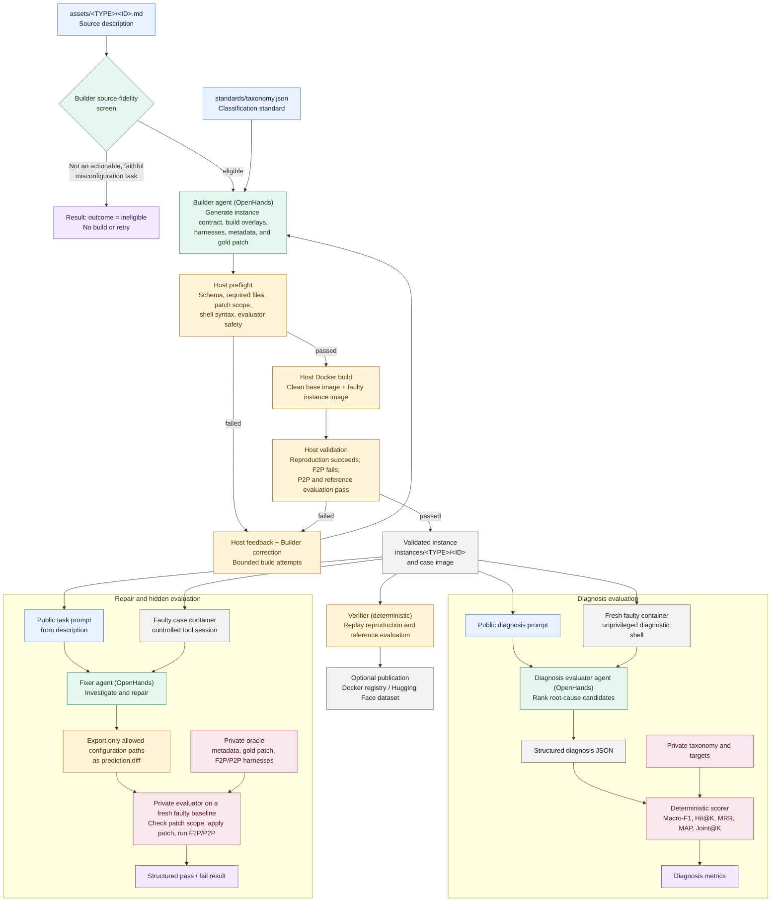

# MisconfigBench Workflow

MisconfigBench separates instance construction, deterministic validation, agent
repair, and hidden evaluation. This keeps the repair task realistic while
preventing the fixer from observing the reference answer or evaluator.

## Responsibilities and visibility

| Stage | Main responsibility | Inputs visible to the stage | Output |
| --- | --- | --- | --- |
| Builder | Turn a numbered source description into a runnable case. | Source description and taxonomy. | Instance files, Docker definitions, harnesses, metadata, and reference patch. |
| Host validation | Reject malformed or non-deterministic generated instances before they become cases. | Complete generated workspace. | Build/validation feedback or a validated instance. |
| Verifier | Independently replay the failure and reference repair. It is deterministic, not an LLM agent. | Existing image and private validation harnesses. | Reproducibility evidence. |
| Diagnosis evaluator | Produce a ranked root-cause classification and localization prediction without making repairs. | Public task and a fresh, unprivileged diagnostic container. | Structured diagnosis and token usage. |
| Diagnosis scorer | Compare the structured prediction with hidden taxonomy and target annotations. | Diagnosis JSON and private metadata. | F1, Hit@K, MRR, MAP@5, and Joint@K metrics. |
| Fixer | Diagnose and repair the faulty container using only the public task and allowed tools. | Public task and the faulty runtime. | `prediction.diff` exported from permitted paths. |
| Private evaluator | Score a submitted repair on a new faulty baseline. | Prediction patch plus hidden oracle artifacts. | F2P/P2P-based pass or failure record. |

Run artifacts are written under `runs/`, structured failures under `logs/`, and
per-case console captures under `logs/console/`. The fixer never receives the
private metadata, reference patch, or hidden harnesses.
